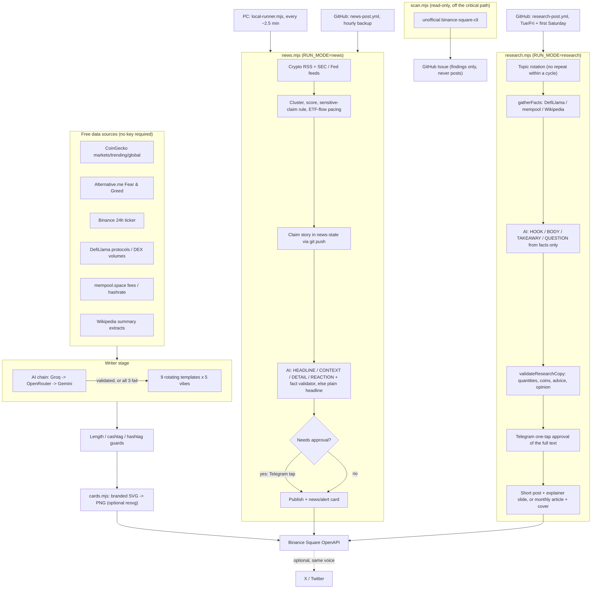

# square-autoposter

A zero-cost crypto content bot for [Binance Square](https://www.binance.com/en/square), driven by GitHub Actions. No server needed — set the secrets below from your phone and it runs itself. Optionally, a Windows/Mac/Linux PC can run a faster breaking-news loop with a local AI model (see **[PC-SETUP.md](PC-SETUP.md)**); GitHub stays on as the always-on backup.

It fetches live market data from free, no-key sources, writes varied posts (rotating templates + a multi-provider AI chain with template fallback), and publishes them through Binance's official Square OpenAPI. Every post carries a branded image drawn in code (`cards.mjs`). A second content line (`research.mjs`) runs the education & research desk: short explainers through the week and one long-form article a month, all written only from fetched facts. A companion scanner reads (never posts) trend/competitor/comment data through an unofficial CLI, entirely off the critical path.

## What it does

- **Daily post** (`daily-post.yml`, 08:30 UTC) — one of 9 rotating content styles (snapshot, top mover, educational, weekly recap, macro overview, anomaly radar, trending today, market sentiment, top-100 digest, coin spotlight), each also rotated against 5 "vibes" (tone/angle). Tries an AI provider chain first (Groq → OpenRouter → Gemini), falls back to a hand-written template if all three fail or produce something that doesn't pass validation. Always attaches a rendered 24h price chart when possible. Philosophy: **post something rather than skip a day.**
- **Breaking news** (`news-post.yml`, hourly on GitHub; `local-runner.mjs`, every ~2.5 min on your PC) — Watcher-Guru-style wire posts. Reads crypto RSS feeds (CoinDesk, Cointelegraph, Decrypt, The Block, Bitcoin Magazine, CryptoSlate) plus the SEC and Federal Reserve press-release feeds (filtered to crypto/macro items), merges the same story across outlets, scores importance (confirmed by multiple outlets, an official source, high-impact keywords like SEC/ETF/hack/Fed, freshness), and posts **at most one story per run — and nothing at all in a quiet hour**. Every post ships with a branded **news card** image (alert cards for sharp single-coin moves). The AI writes four lines — headline, factual context, factual detail, and an attributed reaction — and a validator rejects any number, unit, name or coin that isn't in the source story; on rejection it falls back to the cleaned original headline. Opinions are allowed only as reactions with their owner attached. ETF-flow stories are paced to one per coin per 10 hours so a daily flows stat can't double-post. Hacks, thefts, arrests, bankruptcies, depegs and bans are **never posted on one outlet's word alone**, and can optionally need your one-tap approval on Telegram. A git-based claim lock means the PC and GitHub never post the same story twice.
- **Price alerts** (`local-runner.mjs` every cycle on the PC; `alert-post.yml` manual on GitHub by default) — "Bitcoin falls below $83,000" / "Ether is up 7.3% in 24 hours". Binance's public ticker decides what happened (a round level crossed in the last ~30 min, or a ≥5% 24h move); the AI only phrases it from those validated facts, with a plain data template as fallback. Every alert carries the branded **alert card** (big price, 24h range bar, price line with the crossed level dashed); a plain price chart is the fallback when the PNG renderer isn't installed. Cooldowns per coin/level, a 20/day cap, and the same git claim lock as news — the PC and GitHub never double-alert. With Telegram configured, each alert waits for your one-tap approval.
- **Education & research** (`research-post.yml`, Tue/Fri + first Saturday) — short, data-grounded explainers ("What is TVL?", "Why Bitcoin fees move", "DeFi in numbers today") written ONLY from facts fetched from free sources (DefiLlama, mempool.space, Wikipedia), each with an explainer-slide image, each sent to your Telegram for a one-tap approval before publishing. On the **first Saturday of the month** the same desk produces a long-form research article (sections assembled mechanically from the facts, so their numbers are grounded by construction). A skipped topic is never posted ungrounded.
- **Weekly article** (`weekly-article-telegram.yml`, Sundays 07:30 UTC) — the AI writes the recap from a facts block (market stats, majors' 7-day moves, the headlines this bot posted during the week, each with its publisher), a validator rejects anything the facts don't support, the **whole article is sent to your Telegram**, and it's published — with a branded cover image — **only when you tap Post**. No tap within `WEEKLY_APPROVAL_WAIT_MIN` (default 240 min) = not posted; the draft is kept as an artifact. (The older issue-and-label flow, `weekly-article-draft.yml` + `weekly-article-publish.yml`, still works for manual runs.)
- **Top movers digest** (`top-movers-digest.yml`, 14:00 UTC) — a second, distinct daily post: top-100 breadth (best gainer / worst loser / % green).
- **Scanner** (`trend-scan.yml`, `competitor-scan.yml`, `comment-digest.yml`) — read-only intel via an unofficial headless CLI ([`binance-square-cli`](https://github.com/QuantProcessing/binance-square-cli), pinned to a specific commit). Opens a GitHub Issue with findings; never posts anything itself. See **Risks** below. (v11: the trend-scan and competitor-scan *schedules are off* — Binance blocks the scraper from GitHub's IPs; manual runs still work.)
- **Weekly balance check** (`weekly-balance-check.yml`) — housekeeping (see the workflow file for specifics).
- **Tests** (`test.yml`) — runs the unit and end-to-end suite (`node --test`) on every push/PR touching the source or `test/`.

## Explicitly out of scope

Multi-account farming, automated "Chat Room" community bots, and CreatorPad reward-farming automation are deliberately **not** implemented. The line isn't the technology — it's making one operator's accounts impersonate independent, organically-engaged voices/community. This project is a single account, one voice, syndicated at most to a second platform (X/Twitter), and the AI chain has hard-coded validation against exactly that kind of manufactured-engagement language.

## Setup

**Requires:** Node.js 18+ (built-in `fetch`/`crypto` only — no `npm install`, no `package.json`).

1. Fork/clone this repo.
2. Get a Binance Square OpenAPI key (Square profile → Creator settings) and add it as a repo secret: **`BINANCE_SQUARE_OPENAPI_KEY`**. This is the only required secret.
3. Everything else below is optional — the script degrades gracefully without any of it.
4. Enable GitHub Actions on your fork, then either wait for the cron schedules or trigger `daily-post.yml` manually with **"Dry run" checked** to see what it would post without actually posting.

### Secrets reference

| Secret | Required? | Purpose |
|---|---|---|
| `BINANCE_SQUARE_OPENAPI_KEY` | **Yes** | Posting to Square. Not needed for `RUN_MODE=weekly-draft` (drafting doesn't post). |
| `GROQ_API_KEY` | No | AI provider #1 (free, fast, `openai/gpt-oss-120b`; Groq retired Llama 3.3 70B on 2026-08-16). Get one at [console.groq.com](https://console.groq.com). |
| `OPENROUTER_API_KEY` | No | AI provider #2 (fallback), using OpenRouter's Free Models Router (`openrouter/free`), which always picks a currently-free model. Get a key at [openrouter.ai/keys](https://openrouter.ai/keys). |
| `GEMINI_API_KEY` | No | AI provider #3 (last resort). Get one at [aistudio.google.com/apikey](https://aistudio.google.com/apikey). |
| `COINGECKO_API_KEY` | No, but recommended | Free CoinGecko Demo key. Without it, every request shares the worldwide keyless rate-limit bucket (5–15 req/min). `getMarketData()` is the one call every code path depends on, so this is the single highest-leverage reliability secret to set. Get one at [coingecko.com/en/developers/dashboard](https://www.coingecko.com/en/developers/dashboard). |
| `TWITTER_API_KEY`, `TWITTER_API_SECRET`, `TWITTER_ACCESS_TOKEN`, `TWITTER_ACCESS_TOKEN_SECRET` | No — all 4 or none | Cross-posts the same daily text to X, from the same account/voice. Needs an X developer app set to "Read and Write." X moved new developer accounts to pay-per-use pricing in Feb 2026 — check current pricing before enabling. |
| `SEC_USER_AGENT` | No | Identifies your bot to sec.gov when it fetches the SEC press-release feed, e.g. `my-bot you@example.com`. The SEC asks automated clients to do this; without it the SEC feed may be refused (HTTP 403) and is simply skipped. Only ever sent to sec.gov. |
| `SQUARE_CREATOR_ID` | Only for `comment-digest.yml` | Your own Square creator ID, so the scanner can fetch comments on your own posts. |

Model overrides (all optional, sane defaults baked in): `GROQ_MODEL`, `OPENROUTER_MODEL`, `GEMINI_MODEL`.

### Run modes (`RUN_MODE` env var, set by the workflows — you don't need to touch this directly)

| `RUN_MODE` | What it does |
|---|---|
| unset / `daily` | The normal weekday rotation. No-ops on Sundays (the weekly article owns Sunday). |
| `top-movers-digest` | Forces the top-100 breadth digest style. Runs independent of the Sunday gate. |
| `weekly-draft` | Gathers data, builds the article + a chart preview link, opens/updates a GitHub Issue. Zero Binance calls. |
| `weekly-publish` | Reads the (possibly human-edited) approved issue, uploads the real chart, publishes for real. Fails loudly rather than substituting different content. |
| `news` | Picks the single best fresh story from the feeds and posts it (or posts nothing). Run hourly by GitHub and continuously by `local-runner.mjs`. See below. |
| `alerts` | Checks Binance prices for level crossings and big 24h moves; posts at most one alert, with the branded alert card. Run by the PC runner every cycle; `alert-post.yml` on GitHub is manual by default. |
| `research` | The education & research desk: picks a topic by rotation, fetches its facts (DefiLlama / mempool.space / Wikipedia), writes from those facts only, validates, asks on Telegram, publishes. `RESEARCH_MODE=auto` posts a short explainer and — on the first Saturday of the month — a long-form article instead. |
| `weekly-approve` | Writes the AI weekly article from facts, sends the full text to Telegram, publishes only on your Post tap (used by `weekly-article-telegram.yml`). |

Diagnostics: `DRY_RUN=true` (print, don't post — covers every code path, including image upload), `DAY_INDEX_OVERRIDE=<1-31>` (test a specific vibe/template rotation on demand).

### Breaking-news mode: tuning and limits

GitHub runs it from `news-post.yml` every hour. Manual runs default to **dry run** (prints the chosen story and post, publishes nothing, changes no shared state), so preview first: Actions → Breaking News Post → Run workflow. On a PC, `node local-runner.mjs --dry-run` does the same on a loop.

| Env var | Default | Effect |
|---|---|---|
| `NEWS_MIN_SCORE` | 35 | Importance bar. Lower = more posts, higher = only big stories. The run log lists the top 5 candidates with the reason for each score, so tune from real runs. |
| `NEWS_MAX_AGE_HOURS` | 6 | Ignore stories older than this. |
| `NEWS_MAX_PER_DAY` | 40 | Hard daily cap (UTC day), shared by the PC and GitHub. |
| `NEWS_MIN_GAP_MIN` | 5 | Minimum minutes between two posts, shared by the PC and GitHub (`0` = off). |
| `NEWS_CARDS` | true | Branded card image on every news post (`false` = text-only). PNG rendering needs the one-time `npm install --no-save @resvg/resvg-js` (the workflows do it; the PC setup covers it too). |
| `ALERT_CHART_HOURS` | 24 | Window for the alert card's price range. |
| `CARD_SCALE` | 2 | PNG render multiplier (2 = 2160×2160 for a 1080 card). |
| `NEWS_REQUIRE_AI` | false | `true` = skip a story rather than post the plain-headline fallback. |
| `NEWS_EXTRA_FEEDS` | none | Add feeds without editing code: `Name|https://url,Name2|https://url2`. |
| `NEWS_APPROVAL` | `sensitive` if Telegram is set up, else `off` | `off` / `sensitive` / `all`. Which stories wait for your tap on Telegram. |
| `NEWS_APPROVAL_WAIT_MIN` | 8 | How long a draft waits for a tap. No tap = not posted. |
| `NEWS_GIT_SYNC` | `true` in `news-post.yml`; automatic on the PC runner | Claim stories through git so two machines can't double-post. Needs the folder to be a git clone. |
| `NEWS_CROSSPOST_X` | false | Also post to X (needs the 4 `TWITTER_*` secrets; X bills per post). |
| `OLLAMA_MODEL`, `OLLAMA_BASE_URL`, `AI_PROVIDER_ORDER` | none | Local model via [Ollama](https://ollama.com) and the order AI providers are tried in. See PC-SETUP.md. |
| `NEWS_POLL_SEC` | 150 | PC runner only: seconds between checks (minimum 30). |

How two machines share one state file: before publishing, a runner writes a *claim* for the story into `news-state/posted.json` and pushes it to the repo's main branch. Git only accepts a push built on the current tip, so if the other machine claimed first, this push is rejected; the loser re-reads the state, sees the claim and picks something else or stands down. If publishing then fails, the claim is released so the story can be retried. The claim commits are made without touching your working tree or checked-out branch.

Things to know:

- **It reports, it doesn't verify.** The bot trusts the outlets it reads. A wrong story from a feed becomes a wrong post. The attribution line, the importance threshold, the two-outlet rule for sensitive claims and optional Telegram approval limit that, but they don't remove it. For a human check on everything, set `NEWS_APPROVAL=all`.
- **If Telegram isn't configured on a runner, that runner posts sensitive stories without a tap** once two outlets (or an official source) carry them. Add the `TELEGRAM_*` secrets to the workflow too if you want approval on GitHub-posted stories as well.
- **A local 3-4B model is a fallback writer, not a reporter.** The facts always come from the feeds; the model only rewrites a headline, and the validator throws away anything it invented. Expect more template-fallback posts than with a large cloud model.
- **Feeds can block GitHub's IPs.** Some publishers challenge datacenter traffic. A feed that fails is skipped and shown in the run's Job Summary; if *all* fail, the run posts nothing and says so. A home PC usually isn't blocked, which is one more reason to run one.
- **Posts carry the outlet name, not its text.** The fallback reuses the publisher's headline (short, attributed). The AI path rewrites it. Neither copies article bodies.
- **No DYOR line on news posts** — they report events rather than comment on price. Add one in `assembleNewsPost()` if you want it.
- **Commit noise:** each claim is a small commit to `news-state/posted.json` on your main branch (a dozen or two a day).

## Architecture



## Risks & mitigations

- **Free-tier rate limits/changes** (CoinGecko, Groq, OpenRouter, Gemini) — multi-provider AI fallback + template fallback already absorb provider outages. Set `COINGECKO_API_KEY` (see above) to move off the shared keyless bucket for the one call every path depends on.
- **Binance Square API/content-policy changes** — `MAX_CASHTAGS_PER_POST = 3` and explicit `contentType` are both there because of specific past API errors (see comments in `post.mjs`). Watch the [official skills-hub repo](https://github.com/binance/binance-skills-hub) for changes.
- **Unofficial scraper (`scan.mjs`) blocked or IP-banned** — read-only, no login/credentials, bounded to the GitHub Actions IP range (not your personal IP), and never on the critical path — a scanner failure never affects daily posting. Each mode now writes a clear "scraper unavailable" line to the run's Job Summary instead of only the console log, so a block is visible without opening logs.
- **Human-approval bottleneck for weekly articles** — no automatic reminder yet if a draft sits unlabeled; worth adding if it becomes a recurring problem.
- **X/Twitter pricing** — check your own developer dashboard before enabling; this changed in Feb 2026 and may change again.

## Observability

Every daily-post run writes a **Job Summary** (visible in the Actions run's "Summary" tab, no extra clicks) with: style used, source (AI provider or template/fallback), character count, cashtags, hashtags, whether a chart was attached, dry-run status, and a link to the published post if successful. The scanner workflows write a one-line health status (OK / blocked) the same way.

## Testing

```
node --test
```

No `npm install` needed. The suite covers the pure functions (formatters, template builders, the AI-output validation gates — news AND research AND the weekly article — the card engine, cashtag/hashtag logic, OAuth 1.0a signing, news clustering/scoring/validation, ETF-flow pacing, opinion-attribution rules, alert level/move detection and cooldowns, the research topic engine and fact parsers, the Telegram approval flow against a fake server, the git claim lock against real local git remotes) with no real network calls. **323 tests.**

`test/e2e-news.test.mjs` also runs the real `post.mjs` in news mode as two "machines" at once against a local bare git repo, with `fetch` mocked (`test-support/mock-fetch.mjs`), and asserts exactly one post comes out — plus the Telegram approve/reject/timeout paths, local-model fallback, publish-failure claim release and feed caching. `test/e2e-alerts-weekly.test.mjs` does the same for alerts (two machines, one alert, cooldown rerun, the AI-invents-a-number rejection, the 220009 daily-limit path) and the weekly article (full-text Telegram approval, invented-number fallback to the template, dry run). Both need `git` installed and are skipped without it.

What the tests **cannot** prove: live feed URLs and formats (news feeds, DefiLlama, mempool.space, Wikipedia), how fast your CPU runs a local model, real card rendering with system fonts, and real Telegram behaviour. Do a `--dry-run` first (see PC-SETUP.md).

The scanner (`scan.mjs`) and the daily-post network paths are still not covered.

## Project status

This is a personal/single-account tool, not a maintained public library. Issues and roadmap items live in the repo's GitHub Issues; there's no support SLA. Contributions are welcome in spirit but there's no `CONTRIBUTING.md` or license decided yet — ask before assuming reuse terms.
